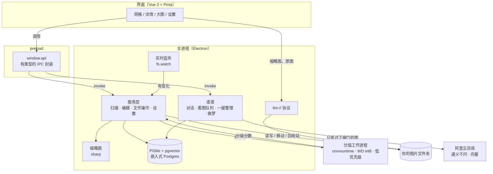
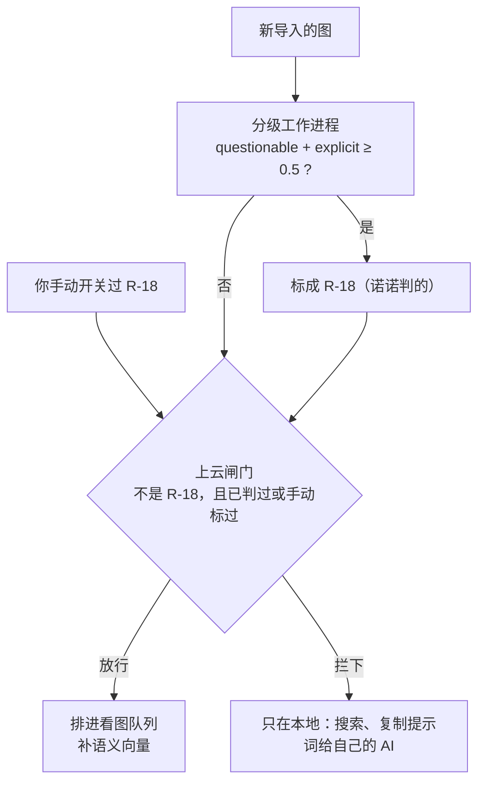
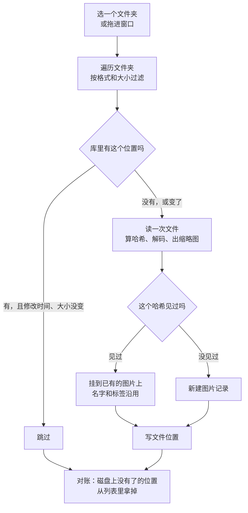
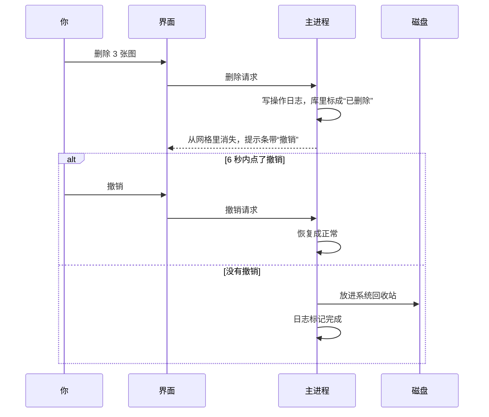
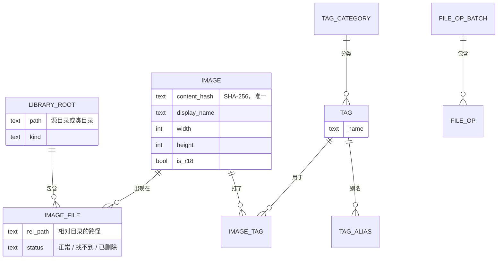

<p align="center">
  
</p>

<p align="center">一个只在自己电脑上运行的图库管理工具：把散在各处的图片文件夹收进来，起名字、打标签、分类、找图、看大图；还有一个会看图、会帮你整理的小助手“诺诺”。</p>

<p align="center">
  Electron · Vue 3 · PGlite · sharp · onnxruntime · 通义千问 · Windows
</p>

---

## 为什么做它

电脑里的图越攒越多：壁纸、截图、画师的作品、自己拍的照片，散在好几个盘、几十个文件夹里。资源管理器能翻，但没法给一张图记“这是谁画的、属于哪个系列”，也没法一下子找出“所有带猫、还没整理过的横图”。

诺诺的图床就是为这件事做的。它不搬动你的原图，只在旁边建一份索引：原来的文件夹照旧能用，图库里多了名字、标签、分类和缩略图。图库数据都在本机，不需要账号。

AI 部分（诺诺）是可选的：配置了阿里云百炼的密钥才会调用云端，没配也不影响其他功能。R-18 判定在本地完成，判为 R-18 的图永远不上云；AI 只给建议，改名字、打标签、动文件都要你点头。

<p align="center">
  
  
</p>

## 能做什么

**收图**
- 导入任意文件夹作为“源目录”，原图留在原地；第一次导入会扫一遍，生成缩略图、读出拍摄信息。
- 开着实时监听时，在资源管理器里新增、删除、改名的图会自动同步；外部删掉的图直接从列表里消失，放回来后按内容认回原来的名字和标签。
- 支持 JPG、PNG、GIF、WEBP、BMP、AVIF、HEIC 和常见 RAW。

**整理**
- 给图起名字、打标签（每张最多 5 个），标签按“角色、作品、画师、地点……”分类，可以有别名，可以合并。
- “类目录”是你自己建的分类文件夹，图可以复制或移动进去；复制、移动、删除都能撤销，删除走系统回收站。
- 一张图同时出现在几个文件夹里时，按内容哈希归成同一张，名字和标签只记一份。

**找图**
- 按名字和标签搜索，按标签、目录、格式、方向、尺寸、文件大小、拍摄时间筛选。
- 网格按原比例排成等高的行，像相册一样按月份分组；Ctrl + 滚轮调缩略图大小。
- R-18 开关：打开后缩略图默认模糊，单独有一个视图。

**本地 R-18 分级**
- 导入后在后台用本地模型（WD swinv2 tagger v3）逐张判一遍，明显的直接标成 R-18，详情里写“诺诺判的”；你手动开关过的永远以你为准。
- 只用 CPU、低优先级，平时 2 线程，电脑空闲且插着电时用 4 线程；你点开的图插队先判，其余新导入的在前。判过的不再重判。
- 默认用 int8 量化版模型，一张约 0.56 秒（原版约 1.1 秒），在 679 张图上验证过 R-18 零漏判。底栏的“本地分级中”胶囊显示进度。

**诺诺（AI 助手）**
- 用一句话找图：“上个月导入的竖版壁纸”“还没打标签的猫”。能在本地对上的直接查库，不调模型；对不上的交给通义千问，配合语义向量检索；也可以上传一张图找相似的。
- 诺诺看图：新导入的图判完分级后自动排队给视觉模型看，拿回名字、角色、作品、标签、出处和一句描述，放进“AI 建议”逐条确认。图多时自动走半价的批量推理。
- 一键整理：诺诺先看图，再拟一份“建哪些类目录、哪些图放进去”的方案；你改好、批了，才按方案复制（不是移动）进类目录，结果同样进“AI 建议”，可以按目录整组采用，A / X 快速审。
- 会记住你的整理习惯：手动改的名字、常移去的目录、明说的偏好，在空闲时“做梦”整理成档案，之后的建议更像你自己起的。
- 用不了云端的图（比如 R-18）可以复制一段提示词给你自己的 AI，再把回复贴回来，由本地对齐成建议。

**看图**
- 双击、回车或空格打开大图，以鼠标位置为中心缩放，拖动平移，旋转、翻转。
- 左右键翻页，切换时先显示缩略图再换成原图，前后两张提前读好，翻起来不用等。

**外观**
- 浅色、深色、跟随系统，六种主题色。
- 几张主题背景，或者用自己的图片作背景；面板透明度和磨砂玻璃可调。
- 窗口记得上次的位置和大小。

## 它是怎么工作的

整个应用分三层：界面只负责显示和交互，所有读写文件、数据库的事都在主进程里做，两边通过一组有类型的 IPC 接口说话。图片本身不经过 IPC，界面用自定义协议 `ltm://` 直接取缩略图和原图。



### 本地分级和上云闸门

一张图能不能发给云端，只看本地的结论。还没判完、判不了的一律不发。



### 导入和扫描

扫描只处理新的或变了的文件。判断“变没变”看修改时间和大小，内容身份看 SHA-256：同样的内容不管在几个位置、叫什么名字，都只有一条图片记录。



扫描期间界面照常可用，缩略图生成好一张显示一张。监听到的变化会先等一阵（1.5 秒）再合并成一次扫描，复制一大批图时不会扫几百次；应用自己做的移动、复制、删除不会触发重扫。

### 删除、移动和撤销

所有会动到磁盘的操作都先记操作日志，再执行。删除不会马上进回收站，而是先在库里藏起来，等提示条上的“撤销”过期才真正执行，所以撤销是即时的。应用中途退出或崩溃时，下次启动会按日志把没做完的补完。



复制和移动从不覆盖已有文件，重名时自动加编号，比如 `风景 (2).jpg`。移动先在目标处占好位置再挪，跨盘时复制完才删原文件。

### 数据模型



一张“图片”是一份内容，一个“文件”是这份内容在磁盘上的一个位置。名字、标签、R-18 记在图片上，所以同一张图复制到几个类目录里，改一处处处都变。

## 数据放在哪里

| 内容 | 位置 |
| --- | --- |
| 图库数据库、缩略图、日志、窗口位置、诺诺的记忆和对话 | `%APPDATA%\LocalToolManage` |
| 本地分级模型（第一次用时自动下载） | `%APPDATA%\LocalToolManage\models` |
| 类目录（你建的分类文件夹） | 默认 `D:\诺诺图床`，可在设置里改 |
| 原图 | 留在你导入的文件夹里，应用不会搬动 |
| 云端密钥 | 只从环境变量读：`DASHSCOPE_API_KEY`（百炼），`ALIYUN_ACCESS_KEY_ID`、`ALIYUN_ACCESS_KEY_SECRET`（以图搜图用的 OSS 临时上传）；不落库、不写日志 |

发给云端的图会先缩小、去掉 EXIF；需要公网地址时私有上传到 OSS 的临时目录，用完立刻删掉。

设置里可以打开数据文件夹、清理用不到的缩略图，或者把整个图库数据库导出成一个备份文件（不含图片本身）。

## 快捷键

| 操作 | 按键 |
| --- | --- |
| 打开大图 / 快速预览 | Enter / 空格 |
| 上一张、下一张 | ← → |
| 上一行、下一行 | ↑ ↓ |
| 第一张、最后一张 | Home / End |
| 多选、连选、全选 | Ctrl + 点击、Shift + 点击、Ctrl + A |
| 复制图片到剪贴板 | Ctrl + C |
| 删除 | Delete |
| AI 建议全部采用 / 不要 | A / X |
| 搜索 | Ctrl + F |
| 缩略图大小 / 大图缩放 | Ctrl + 滚轮 |
| 大图放大、缩小、适应窗口、原始大小 | + − 0 1，或双击 |

## 开发

需要 Node.js 22 和 Windows。

```powershell
npm install
npm run dev          # 开发模式，数据放在 D:\ltm-dev，不碰真实数据
npm run typecheck
npm test             # 单元测试
npm run build
npm run test:e2e     # 端到端测试（先 build），用 Playwright 驱动真实的 Electron 窗口
```

开发和测试都通过环境变量 `LTM_DATA_DIR`、`LTM_CATEGORY_HOME` 把数据隔离到别的目录。端到端测试除了逐个功能检查，还有一个模拟用户把所有功能点一遍的流程，以及一组极端情况：空文件、坏文件、九千万像素的大图、很深的目录、带表情的长文件名、运行中源目录被整个删掉等。

本地分级模型可以用 `LTM_MODEL_DIR` 指到一个共用目录（开发和测试共用 `D:\ltm-dev\models`），省得每个场景都下载一遍。

改了 `src/main/db/schema.ts` 之后运行 `npm run db:generate` 生成新的迁移，迁移只往前加。换应用图标时替换 `resources/icon.png`，再运行 `node scripts/make-icon.mjs`，会生成 Windows 用的 ico 和标题栏小图。

int8 量化模型在本机生成，不联网、不覆盖已有文件，几秒钟就好（需要 [uv](https://docs.astral.sh/uv/)）：

```powershell
uv run -p 3.11 --with onnxruntime==1.32.0 --with onnx==1.23.2 python scripts/quantize-model.py "$env:APPDATA\LocalToolManage\models\wd-swinv2-tagger-v3"
```

模型目录里有 `model.int8.onnx` 时应用自动用它，删掉就回到原版。

```
src/
  main/        主进程：服务、数据库、扫描、监听、文件操作、ltm:// 协议
    services/ai/       诺诺：对话、看图队列、AI 建议、一键整理、记忆和做梦
    services/rating/   本地 R-18 分级（模型下载、选 int8、工作进程调度）
    services/cloud/    百炼和 OSS 临时上传
    workers/           分级工作进程
  preload/     暴露给界面的 window.api
  renderer/    界面：Vue 组件、Pinia 状态、主题
  shared/      两边共用的类型和设置定义
drizzle/       数据库迁移
scripts/       开发隔离启动、生成图标、生成 int8 模型
tests/         单元测试和端到端测试
docs/          设计文档、界面原型和生图说明
```

## 致谢与许可

- 主题背景 Halftone、Plotter、Paper 移植自 Claude Code 官方 theme-examples 插件，按 Apache-2.0 使用。
- 界面字体是 Nunito 和 Noto Sans SC。
- 本项目以 MIT 许可证发布，见 [LICENSE](LICENSE)。
