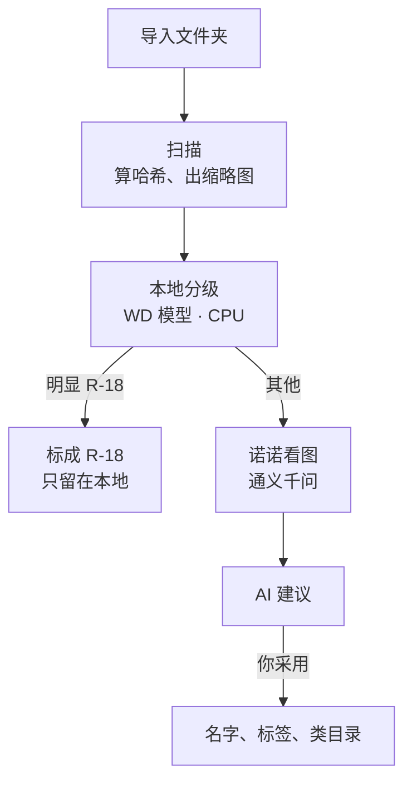

<p align="center">
  
</p>

***

<h1 align="center">诺诺的图床</h1>

<p align="center">Windows 本地图床与看图整理工具，带着「诺诺」一起收图、打标签和找图。</p>

<p align="center">
  
  
  
</p>

<p align="center">
  
  
  
  
  
  
</p>

<p align="center">
  <a href="#功能">功能</a> ·
  <a href="#截图">截图</a> ·
  <a href="#工作原理">工作原理</a> ·
  <a href="#隐私和数据">隐私和数据</a> ·
  <a href="#开发">开发</a>
</p>

---

图存多了以后，壁纸、截图、插画和照片很容易散在各个盘的文件夹里，想用时怎么翻都找不到。把这些文件夹添进「源目录」，就能在一个界面里按时间、标签和尺寸统一看图，原图照样留在原来的位置。

- **数据留在本地**：图库索引、缩略图和设置都存放在自己电脑上，不用注册账号；R-18 只在本地跑模型判断，不发往云端。
- **AI 按需启用**：填了阿里云百炼 API Key 才会用到诺诺看图和对话，没配置时照样是一套完整的本地图库。
- **改动由你决定**：起名、打标签、建类目录或者挪动文件，AI 只负责给出建议和方案，确认了才会落库或写盘。

## 功能

| 功能 | 说明 |
| --- | --- |
| **收图与监听** | 添加任意本地文件夹即可导入，原图不动；实时同步外部的新增、删除和改名，同内容图片自动去重。支持 JPG、PNG、GIF、WEBP、BMP、AVIF、HEIC 及常见 RAW。 |
| **分类与整理** | 自定义图片名称、分类标签及别名，并用「类目录」按主题归档；复制、移动和删除均支持撤销，删除走系统回收站；已归档的图片支持在弹窗或详情栏按单图/批量「回归源目录」或让「诺诺重新看」。 |
| **检索与看图** | 支持按名字、标签、目录、方向、尺寸和导入时间筛选；按月分段网格搭配虚拟滚动，大图查看支持缩放、旋转、翻转与键盘切图。 |
| **本地 R-18 分级** | 导入后在独立子进程用 CPU（int8 模型）后台慢速判图，明显的自动标上 R-18；你手动改过的分级结果永远优先。 |
| **诺诺助手** | 可以直接用自然语言聊天或找图（只在类目录的已确认标签范围里检索），也能上传图片按画面找相似，或附带 Markdown 说明看图。 |
| **AI 建议** | 过了本地分级的非 R-18 新图自动交给诺诺看图，生成名字、标签、角色、作品和出处建议，支持逐条采纳、整张采纳以及单图重看。 |
| **一键整理与用量统计** | 按你的目录规则拟好建目录和归档方案，批准后执行；「设置 → AI」里可直接查看按自然年切换的年度热力图、7天/15天/30天/6个月/1年趋势柱图、五维效率雷达与费用估算。 |
| **外观定制** | 支持浅色、深色和跟随系统，多套主题色、主题背景及自定义壁纸，透明度与磨砂效果实时联动。 |

## 截图

<p align="center">
  
  
</p>
<p align="center">
  
  
</p>

## 工作原理

一张新图进库之后会经过这条流程：



- **前后端进程隔离**：Vue 界面只负责展示与交互，文件读写和数据库操作都在 Electron 主进程完成；图片经自定义 `ltm://` 协议直接读取，不经 IPC 传大图。
- **嵌入式 Postgres + pgvector**：内置 PGlite 与向量检索扩展，开箱即用，不需要额外安装数据库服务。
- **后台低负载分级**：分级在单独的工作进程运行，前台活跃时 3 线程、空闲或切到后台时 4 线程，尽量不抢桌面响应。
- **磁盘操作先记日志**：删除和挪动先写入状态日志再改磁盘，支持即时撤销与意外退出后的启动恢复，复制与移动默认不覆盖已有文件。

## 隐私和数据

| 内容 | 位置 |
| --- | --- |
| 图库数据库、缩略图、日志、对话记录与凭证 | `%APPDATA%\LocalToolManage` |
| 本地分级模型（首次启用时下载） | `%APPDATA%\LocalToolManage\models` |
| 类目录 | 新图库默认位于应用数据目录下的「类目录」，可在设置里查看路径 |
| 原图 | 导入后留在原本的源目录文件夹中 |

- 在「设置 → AI」填写百炼 API Key（默认读取系统环境变量 `DASHSCOPE_API_KEY`）；手动填写的内容离开输入框后即加密保存在本地并优先使用。
- 只有通过本地分级的非 R-18 图片才会发给云端；上传前先做缩图并剥离 EXIF 元数据，直接通过 base64 发送给百炼接口，不再经过第三方对象存储中转。
- 也可以从图片详情页复制提示词，把图片交给其他常用的 AI 处理后再把结果贴回来导入。
- 设置的「数据与缓存」里支持整库导出备份（不包含原图文件本身）。

## 开发

需要 Windows 与 Node.js 22.12 或更高版本。

```powershell
npm install
npm run dev          # 开发模式，数据隔离在 D:\ltm-dev，不碰真实图库
npm run typecheck
npm test             # 单元测试
npm run build        # 构建产物并刷新桌面快捷方式
npm run test:e2e     # 端到端测试（先 build），Playwright 驱动真实 Electron 窗口
```

- 通过环境变量隔离数据目录：`LTM_DATA_DIR`、`LTM_CATEGORY_HOME`、`LTM_MODEL_DIR`。
- 调整 `src/main/db/schema.ts` 后运行 `npm run db:generate`，迁移只增不删。
- 更换图标：替换 `resources/icon.png` 后运行 `node scripts/make-icon.mjs`。
- 重新生成 README 截图：`$env:LTM_SHOTS='1'; npx vitest run --maxWorkers=1 tests/e2e/readme-shots.test.ts`（使用合成风景图和本地模拟百炼接口）。
- 本地生成 int8 分级模型（需要 [uv](https://docs.astral.sh/uv/)）：

```powershell
uv run -p 3.11 --with onnxruntime==1.32.0 --with onnx==1.23.2 python scripts/quantize-model.py "$env:APPDATA\LocalToolManage\models\wd-swinv2-tagger-v3"
```

```
src/
  main/
    config/            模型计价、配置键与百炼客户端参数
    db/                PGlite 实例、Drizzle Schema 与迁移执行
    ipc/               IPC 通道注册
    protocol/          ltm:// 缩略图与原图直出协议
    repositories/      SQL 谓词与数据访问
    services/ai/       诺诺对话 harness、看图、建议、整理、重新整理、记忆与用量统计
    services/fileOps/  目录与文件安全复制、移动、删除及恢复
    services/rating/   本地 WD int8 R-18 分级调度
    services/scan/     图片探测、缩略图与目录增量监听
    workers/           分级子进程入口
  preload/             通过 contextBridge 暴露的 window.api
  renderer/            Vue 3 界面、Pinia 状态与主题变量联动
  shared/              主进程与渲染层共用的 IPC 协议、设置与常量
drizzle/               数据库 SQL 迁移脚本
scripts/               隔离开发启动、桌面快捷方式、图标与量化脚本
tests/                 单元测试（tests/unit）与 Playwright 端到端测试（tests/e2e）
docs/                  设计文档、重构记录与原型稿
```

完整设计见 [docs/design.md](docs/design.md)。

## 致谢与许可

- 主题背景 Halftone、Plotter、Paper 移植自 Claude Code 官方 theme-examples 插件，按 Apache-2.0 使用。
- 界面字体使用 Nunito 与 Noto Sans SC；本地分级模型来自 [SmilingWolf/wd-swinv2-tagger-v3](https://huggingface.co/SmilingWolf/wd-swinv2-tagger-v3)。
- 本项目以 MIT 许可证发布，见 [LICENSE](LICENSE)。
