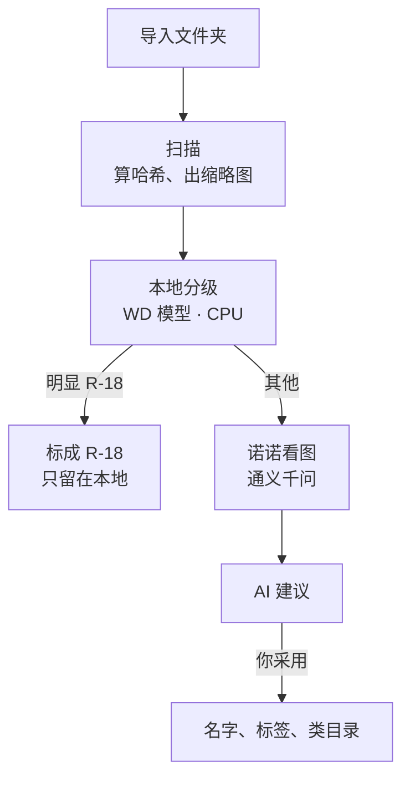

<p align="center">
  
</p>

<h1 align="center">诺诺的图床</h1>

<p align="center">只在你电脑上运行的图库管理工具，附带一个会看图、会帮你整理的小助手“诺诺”。</p>

<p align="center">
  
  
  
</p>

<p align="center">
  
  
  
  
  
  
</p>

<p align="center">
  <a href="#功能">功能</a> ·
  <a href="#截图">截图</a> ·
  <a href="#它是怎么工作的">工作原理</a> ·
  <a href="#隐私和数据">隐私和数据</a> ·
  <a href="#快捷键">快捷键</a> ·
  <a href="#开发">开发</a>
</p>

---

电脑里的图越攒越多：壁纸、截图、画师的作品、自己拍的照片，散在好几个盘、几十个文件夹里。诺诺的图床不搬动你的原图，只在旁边建一份索引，让你能给图起名字、打标签、分类，再一句话把图找出来。

- **本地优先**：图库数据都在本机，不需要账号；R-18 在本地判定，永远不上云。
- **AI 可选**：配置了阿里云百炼的密钥才会用到诺诺，没配也不影响其他功能。
- **AI 只给建议**：改名字、打标签、动文件，都要你点头。

## 功能

| 功能 | 说明 |
| --- | --- |
| **收图** | 导入任意文件夹，原图留在原地；实时监听新增、删除、改名；同一张图在几个地方出现时只算一张。支持 JPG、PNG、GIF、WEBP、BMP、AVIF、HEIC 和常见 RAW。 |
| **整理** | 名字、标签（带分类和别名）、自建的“类目录”；复制、移动、删除都能撤销，删除走系统回收站。 |
| **找图、看图** | 按名字和标签搜，按目录、方向、尺寸、时间筛；网格按月分组；大图缩放、旋转、翻页不用等。 |
| **本地 R-18 分级** | 导入后在后台用本地模型逐张判，明显的自动标上；你手动改过的永远以你为准。int8 量化模型约 0.56 秒一张，只用 CPU、低优先级。 |
| **诺诺助手** | 一句话找图（“找海边的风景”），在已确认标签的图片中检索，跳过待审建议。可以上传一张图找相似图片，也可以附上 Markdown 提示词，让诺诺按文件要求看图。 |
| **AI 建议** | 新图判完分级后诺诺自动看一遍，给出名字、标签、角色、作品、出处，逐条采用或不要，按 A / X 快速审。 |
| **一键整理** | 诺诺拟一份“建哪些类目录、哪些图放进去”的方案，你改好、批了才复制进去。 |
| **外观** | 浅色、深色、跟随系统，六种主题色，主题背景或自己的图，磨砂玻璃和透明度可调。 |

## 截图

<p align="center">
  
  
</p>
<p align="center">
  
  
</p>
<p align="center"><sub>左上、右上：图库的浅色和深色　·　左下：诺诺助手一句话找图　·　右下：AI 建议逐条采用</sub></p>

## 它是怎么工作的

一张新图进来以后会经过这几步：



- **界面和主进程分开**：界面（Vue）只管显示，读写文件和数据库都在 Electron 主进程里做，图片用 `ltm://` 协议直接读，不经过 IPC。
- **数据库是嵌入式的 Postgres**（PGlite），带 pgvector 做语义搜索，不用装任何服务。
- **分级在单独的进程里跑**，进程优先级调低；你在用软件时 3 线程，切到别处或电脑空闲（插着电）时 4 线程，不会把电脑卡住。
- **动磁盘的操作先记日志再执行**：删除先在库里藏起来，撤销是即时的；中途崩溃下次启动会补完。复制和移动从不覆盖已有文件。

## 隐私和数据

| 内容 | 位置 |
| --- | --- |
| 图库数据库、缩略图、日志、诺诺的记忆和对话 | `%APPDATA%\LocalToolManage` |
| 本地分级模型（第一次用时自动下载） | `%APPDATA%\LocalToolManage\models` |
| 类目录 | 默认 `D:\诺诺图床`，可在设置里改 |
| 原图 | 留在你导入的文件夹里，应用不会搬动 |

- 在「设置 → AI」中填写云端密钥。默认读取 `DASHSCOPE_API_KEY`（百炼）、`ALIYUN_ACCESS_KEY_ID` 和 `ALIYUN_ACCESS_KEY_SECRET`（阿里云 OSS）。离开密钥输入区时自动加密保存填写的值，并优先使用。
- 检测到用户环境变量 `ALIYUN_TOKEN_PLAN_KEY` 时，图库进入本地模式，保留类目录检索和本地缓存，停用按量模型调用。个人套餐可在受支持的工具中交互使用。[阿里云 Token Plan 使用规范](https://help.aliyun.com/zh/model-studio/token-plan-permissions-and-usage)
- 发给云端的只有过了本地分级的图，先缩小、去掉 EXIF；需要公网地址时私有上传、用完即删。
- 云端用不了的图（比如 R-18），可以复制一段提示词给你自己的 AI，把回复贴回来，由本地整理成建议。
- 设置里可以导出整个图库数据库作备份（不含图片本身）。

## 快捷键

| 操作 | 按键 |
| --- | --- |
| 打开大图 / 快速预览 | Enter / 空格 |
| 翻页、换行、第一张 / 最后一张 | ← → ↑ ↓、Home / End |
| 多选、连选、全选 | Ctrl + 点击、Shift + 点击、Ctrl + A |
| 复制图片、删除、搜索 | Ctrl + C、Delete、Ctrl + F |
| AI 建议全部采用 / 不要 | A / X |
| 缩略图大小 / 大图缩放 | Ctrl + 滚轮 |
| 大图放大、缩小、适应窗口、原始大小 | + − 0 1，或双击 |

## 开发

需要 Node.js 22 和 Windows。

```powershell
npm install
npm run dev          # 开发模式，数据放在 D:\ltm-dev，不碰真实数据
npm run typecheck
npm test             # 单元测试
npm run build
npm run test:e2e     # 端到端测试（先 build），Playwright 驱动真实的 Electron 窗口
```

- 数据目录用环境变量隔离：`LTM_DATA_DIR`、`LTM_CATEGORY_HOME`；分级模型可以用 `LTM_MODEL_DIR` 指到共用目录。
- 改了 `src/main/db/schema.ts` 后运行 `npm run db:generate`，迁移只往前加。
- 换图标：替换 `resources/icon.png`，运行 `node scripts/make-icon.mjs`。
- README 截图：`$env:LTM_SHOTS='1'; npx vitest run tests/e2e/readme-shots.test.ts`，使用合成图片和模拟百炼响应。
- 生成 int8 分级模型（本机运行、不联网、不覆盖已有文件，需要 [uv](https://docs.astral.sh/uv/)）：

```powershell
uv run -p 3.11 --with onnxruntime==1.32.0 --with onnx==1.23.2 python scripts/quantize-model.py "$env:APPDATA\LocalToolManage\models\wd-swinv2-tagger-v3"
```

```
src/
  main/        主进程：扫描、监听、文件操作、数据库、ltm:// 协议
    services/ai/       诺诺：对话、看图、AI 建议、一键整理、记忆
    services/rating/   本地 R-18 分级
    services/cloud/    百炼和 OSS 临时上传
    workers/           分级工作进程
  preload/     暴露给界面的 window.api
  renderer/    界面：Vue 组件、Pinia 状态、主题
  shared/      两边共用的类型和设置
drizzle/       数据库迁移
scripts/       开发启动、图标、int8 模型
tests/         单元测试和端到端测试
docs/          设计文档、界面原型
```

完整设计见 [docs/design.md](docs/design.md)。

## 致谢与许可

- 主题背景 Halftone、Plotter、Paper 移植自 Claude Code 官方 theme-examples 插件，按 Apache-2.0 使用。
- 界面字体是 Nunito 和 Noto Sans SC；本地分级模型是 [SmilingWolf/wd-swinv2-tagger-v3](https://huggingface.co/SmilingWolf/wd-swinv2-tagger-v3)。
- 本项目以 MIT 许可证发布，见 [LICENSE](LICENSE)。
