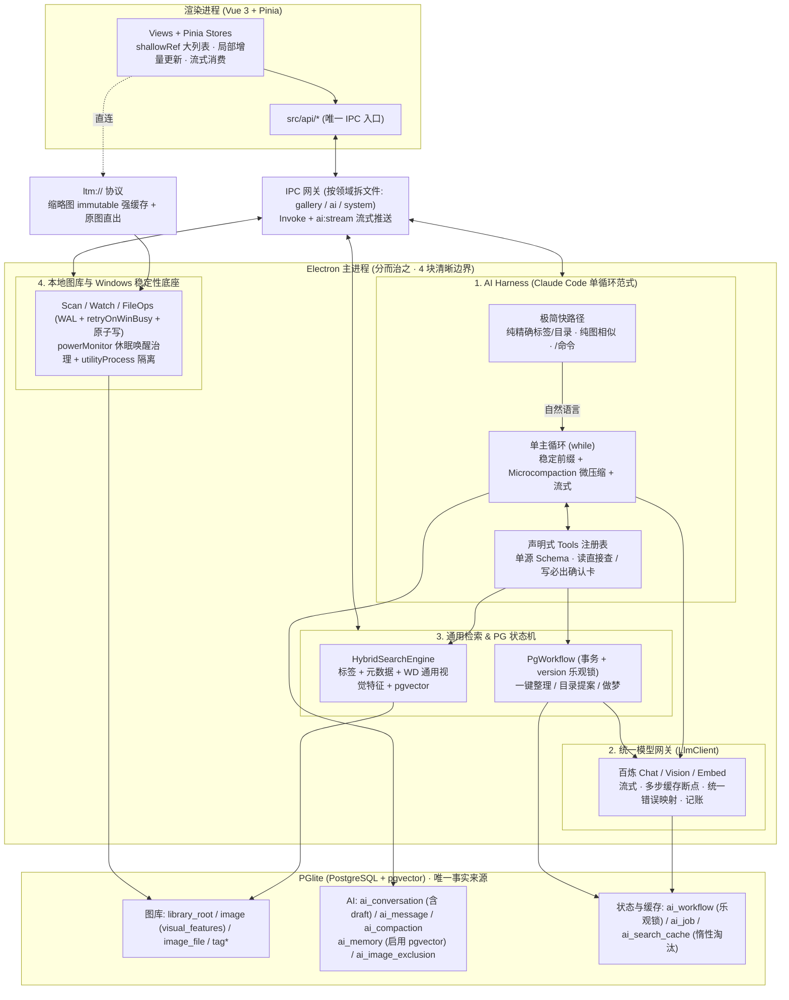

# 诺诺的图床 · 架构重构与稳定性总文档（v1.1）

## 一、核心原则（防技术债的 4 条硬护栏）

1. **去硬编码（配置与数据驱动）**
   - **AI 侧**：彻底移除按特定词汇/句式写的中文正则与特征特判（猫耳、发色、建目录、排除图片）；所有模型名、超时、费用估算、缓存阈值收口到统一配置，以后换模型或换服务商只改配置不改业务。
   - **业务侧**：消除多处散落的魔法值与硬编码字符串（如多处硬编码的 `'角色'/'作品'/'主题'` 分类名、`delete_state = 2` 草稿标记、`"以后检索时排除图片 #"` 字符串协议、随处手写的 `split('\\')` 路径拼接）。
2. **分而治之（纯函数核心 + 薄 IO 外壳）**
   - **单向分层**：`Renderer (Views → Stores → src/api/*)` → `IPC (按领域拆分的薄路由)` → `Services (编排)` → `Repositories (唯一 SQL 层)` → `PGlite`；底座核心不依赖任何具体业务。
   - **逻辑与副作用分离**：Prompt 拼接、微压缩、状态转移判断、方案校验、检索条件归约全部写成**无 DB / 无网络 / 无磁盘 IO 的纯函数**，极易单测；外层只做薄的 IO 胶水。
   - **插件式扩展 + 体量红线**：单文件控制在 ~300 行内；新增工具或后台流程只需加一个独立小文件并注册，**绝不往主控文件里塞 `else if`**。
3. **PG 单一事实来源**
   - 长流程状态、断点、缓存、记忆全由 PG 事务 + `version` 乐观锁管理，内存只做无状态执行器（Runner）。
4. **单机极致简单（借鉴 Claude Code Harness + Electron 官方实践）**
   - 零重型框架（无 LangChain / LangGraph / 分布式事件总线），一个干净的 `while` 主循环 + 确定性外骨骼即可打穿全部需求。

---

## 二、Windows 稳定性与极端场景兜底设计

项目已有良好基础（`ltm.lock` + `tasklist` 防 PID 复用、同盘硬链接 `publishExclusive`、Windows 保留名校验、WAL 删除日志），在此之上补齐 5 类 Windows 典型极端场景：

| 极端场景 | Windows 常见触发原因 | 架构级兜底方案 |
|---|---|---|
| **1. 文件句柄瞬时占用** | Defender / 杀毒扫描、资源管理器缩略图预览器锁住刚写入的文件，导致 `rename / unlink / trashItem` 抛 `EBUSY / EPERM` | 抽一个 20 行的 `retryOnWinBusy`（仅对 `EBUSY / EPERM / EACCES` 做 3 次短退避重试 60/180/400ms），统一包在文件操作与缩略图落盘外层；所有本地状态文件（如 `window-state.json`、缩略图）一律 **写 `.tmp` → 原子 `rename`**，杜绝断电损坏 |
| **2. 休眠 / 合盖唤醒 / 关机** | 笔记本合盖休眠后唤醒，长连接、批量轮询、移动硬盘句柄假死；关机时未及时落盘 | 主进程接入 Electron `powerMonitor`：`suspend` 时主动暂停云端轮询与后台任务（不误标失败）；`resume` 时重检根目录在线状态、重建 `fs.watch` 并恢复队列；`shutdown` 走带总超时保护的优雅退出，确保 PGlite 落盘释放锁 |
| **3. 盘符漂移 / 离线盘 / 长路径** | 移动硬盘拔出重插、深层路径、Windows 路径大小写混用 | 路径操作 100% 收口到 `src/main/common/pathUtil.ts`（消除各处散落 `split('\\')`）；任何磁盘写/删遇到 `ENOENT` 前必核验根目录在线，**绝不把离线盘图片误判为删除** |
| **4. 进程异常与坏图隔离** | 渲染进程崩溃白屏、`ratingWorker` (ONNX) 异常退出、单张损坏图片卡死队列 | `render-process-gone` 提供安全重载恢复而非静默白屏；`utilityProcess` 异常退出按指数退避重启（上限 3 次后降级提示，不死循环吃满 CPU）；批处理任务统一走 `AbortSignal` + 单项错误隔离（单张坏图只标自身失败，不阻断队列） |
| **5. 极端断电防库损** | 强断电或强制杀进程导致嵌入式 PGlite 异常 | 严格保证 `will-quit` 顺序落盘；在数据目录保留轻量**定期元数据自动快照轮转**（如保留最近 3 份，按需一键恢复），保护用户长期积累的标签与记忆 |

---

## 三、全局目标架构图

---

## 四、AI 子系统与桌面端关键改造设计

### 4.1 AI Harness（借鉴 Claude Code 公开实践）
- **单主循环（`harness/harness.ts`）**：`while (step < MAX_STEPS)`，拼装四层前缀 → 调用模型 → 有 `tool_calls` 执行并归约 → 直到结束。
- **声明式工具注册表（`harness/toolRegistry.ts` + `tools/`）**：一份 Schema 同时生成 OpenAI `tools` 定义与运行时校验，彻底消灭双写；工具返回不可变 `ToolOutcome` 联合类型，消除 25 字段共享 `TurnContext`。
- **零成本微压缩（`harness/context.ts`）+ 4 断点前缀缓存**：工具循环优先就地折叠更早步骤的冗长工具返回（Microcompaction），结合百炼官方 Prompt Caching 规范进行精准控制：
  - **显式 vs 隐式分工**：显式缓存（`cache_control: { type: 'ephemeral' }`）创建按输入 125% 计费、命中仅 10%（5 分钟 TTL 且每次命中自动续期，最低前缀 1,024 Token、最多 4 个断点、向后回溯 20 个块）；隐式缓存创建 100%、命中 20%。因此 5 分钟内高频复用的 `chat`/`look` 走显式缓存，低频一次性调用（`organize`/`dream`/`compact`/`predict`）走隐式缓存。
  - **断点与 20 块窗口治理**：OpenAI 兼容接口仅在 `system` 与 `user` 的分段 `content` 数组末尾放置 `cache_control` 断点（保持 `role: 'tool'` 为纯字符串，且通过 Microcompaction 控制上下文不溢出 20 块回溯窗口）。
  - **流式记账**：流式请求必须开启 `stream_options: { include_usage: true }`，从尾块采集 `prompt_tokens_details.{cached_tokens, cache_creation_input_tokens}` 写入 `api_usage` 并回显命中率。
- **通用混合检索（`search/visualMatcher.ts` + `search/hybridSearch.ts`）**：AI 动态输出 `visualInclude` / `visualExclude` 标准 Danbooru 视觉标签，PG `jsonb` 通用过滤 `image.visual_features` 并结合 `pgvector` 排序，彻底淘汰 `earSearch.ts`、`visualFollowup.ts` 等硬编码特判。

### 4.2 PG 状态机、记忆向量化与缓存修缮
- **`ai_workflow`**：统一承接一键整理、目录提案、做梦的状态流转与乐观锁 `version`，清理 `app_setting` 业务状态键。
- **`ai_compaction` / `ai_image_exclusion` / `ai_conversation.draft`**：独立成表/列，废除 `delete_state = 2` 与 `"以后检索时排除图片 #"` 字符串协议。
- **`ai_memory` 启用 `pgvector`**：替换内存 2-gram 相似度打分；`ai_search_cache` 改为惰性清理 + 统一 `stableStringify`。

### 4.3 桌面端与图库性能打磨
- `ltm://thumb` 增加 `Cache-Control: public, max-age=31536000, immutable`。
- `stores/gallery.ts` 的 `afterEdit()` 改为局部增量更新，大列表改用 `shallowRef`。
- `galleryService.ts` 的 `more` 筛选与基础排序下推 PG；根目录在线探测加短缓存；按领域拆分 `src/main/ipc/`。

---

## 五、分阶段推进路线图与验收标准

| 阶段 | 核心目标 | 关键交付与清理 | 验收重点 |
|---|---|---|---|
| **阶段 A：AI Harness + 通用动态检索** | 治好对话难用与硬编码正则 | ① 抽 `cloudErrors` 与多步缓存断点；② 建 `harness/`（单循环 + 声明式 `ToolRegistry` + `Microcompaction`）；③ 通用 `visualInclude/visualExclude` 检索；④ 删 `earSearch` / `visualFollowup` 硬编码特判，瘦身 `assistantService.ts` | `typecheck` + 单元 & 助手 E2E 全绿；任意视觉特征组合可动态过滤；缓存命中率不降 |
| **阶段 B：PG 状态机 + 记忆向量化 + 缓存修缮** | 治好状态漂移与缓存写放大 | ① Drizzle 增量迁移：`ai_workflow`、`ai_compaction`、`ai_image_exclusion`、`ai_conversation.draft`；② 一键整理 / 目录提案 / 做梦迁入 `PgWorkflow` 乐观锁；③ `ai_memory` 启用 `pgvector`；④ `ai_search_cache` 惰性清理 + Service 层裸 SQL 收口 | `db:generate` 无多余差异；崩溃/重启恢复单测与 E2E 全绿 |
| **阶段 C：流式对话体验升级** | 补齐助手实时交互体感 | ① 开启流式输出 + `ai:stream` IPC 事件；② 前端 `stores/assistant.ts` 与 `AssistantView` 接入打字机流式文字 + 工具实时状态提示，收口 `src/api/ai.ts` | 流式输出、中断、撤回、重试全链路无竞态 |
| **阶段 D：Windows 稳定性加固 + 桌面端性能打磨** | 极端环境稳如老狗 + 万图丝滑 | ① `retryOnWinBusy` + 原子写 + `powerMonitor` + 进程异常自愈 + 路径收敛；② `ltm://thumb` 强缓存、`afterEdit()` 局部更新、`shallowRef`、`more` 下推 PG、拆分 `ipc/` | `npm run build` + 全量单测 + 性能 E2E 验证 |
